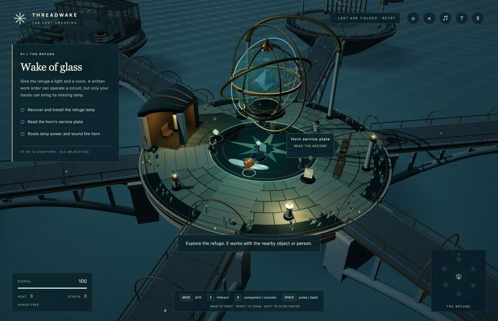

# Threadwake: The Last Crossing

A 3D story of repair, evidence and a floating observatory’s last evacuation. Meet four companions, bring neglected machinery back into service, and decide how shared resources and promises will carry forward.

**[Play in your browser](https://steph4n-gh.github.io/threadwake/)** - no model download required.



**Public alpha.** The authored demo needs no model. Optional local Gemma models add measured signal captures, work-order interpretation and record matching. The full campaign, meaningful play duration and sustained performance across hardware remain under development and review.

## Play

Use Python 3.11 or later from the repository root:

```sh
python3 -B server.py
```

Open [http://127.0.0.1:8769/](http://127.0.0.1:8769/). The demo host uses only Python’s standard library. No build step, Node.js, virtual environment or model download is needed to play it. On macOS, `Launch.command` is an alternative launcher; on Windows, `py -3 -B server.py` may be your Python command.

You need a desktop browser with WebGL2 and JavaScript, plus keyboard and mouse or trackpad. WASD/arrows move, drag/wheel orbit and zoom, E interacts, R opens a nearby console or companion radio, and Escape closes a panel or pauses. The map and journal are J and L.

The original score, *Lanterns on the Glass Meridian*, accompanies procedural sea, wind, machinery and interaction sounds. Open **Sound & music** in pause or H-help to adjust Master, Music, Ambience and Effects; M mutes everything without changing the mix. These preferences persist separately from your crossing. The score is composed in advance; signal tones can reflect retained instrument bands, but no model composes music during play. See [Audio](docs/AUDIO.md) for controls, credits and source details.

- [Player’s field guide](web/guide.html) · [Download the PDF](web/threadwake-field-guide.pdf)
- [Install and launch](docs/INSTALL.md) · [Optional local models](docs/LOCAL_MODEL.md)
- [Story and companions](docs/STORY.md) · [Testing](docs/TESTING.md) · [Release checks and limits](docs/RELEASE_CHECKS.md)

## What makes the signals different?

Each retained profile has Bridge, Shelter and Surge bands. The optical puzzles use the whole distribution, not just the winning action. You blend profiles, route their bands, inspect a safe dry trace and decide when to commit.

**Neural Echo** lets you replay the retained Before or After record through the same optics and mixture weights. A leading action can stay the same while its secondary bands change the route’s result. Local pairs replay an existing measured capture; browser pairs are visibly **AUTHORED** calibrations. The dry trace is safe, and Commit remains a separate choice.

The demo supplies **authored calibrations**, visibly labeled. In optional Apple Silicon local-model mode, E2B can supply **measured spectra** with temporary activation steering. Saved model weights are unchanged. A target direction is not a guaranteed result, and no “personality neuron” is claimed. E4B separately translates discovered controls into reviewed work orders and matches known records or eligible agreements; it does not invent history or accept terms for you.

## Keep your crossing

Saves live in the browser, per origin and slot. Stay with the same hostname, port and browser profile; `localhost` and `127.0.0.1` have different storage. A hosted demo and local host also have separate saves. Keep one active game tab per slot, and preserve site data. Starting a new crossing replaces that slot’s save.

## Contribute

See [CONTRIBUTING.md](CONTRIBUTING.md) for changes and [docs/TESTING.md](docs/TESTING.md) for checks. Report reproducible bugs with the repository’s issue templates. Review logs before sharing them; optional diagnostics can contain private input. Security concerns belong in the process described in [SECURITY.md](SECURITY.md).

## Credits and licenses

Created by the Threadwake contributors with Codex development assistance and independent Gemini/Argon, judge and adversary reviews. Portraits and the roof texture used OpenAI’s image tool; the guide’s scene image is an unmodified gameplay capture. See [ASSETS.md](ASSETS.md) for attribution.

Software we control is Apache-2.0 under [LICENSE](LICENSE). Original story, art and documentation are CC BY 4.0 to the extent rights are held; see [NOTICE](NOTICE) and [the content license](licenses/CC-BY-4.0.txt). Third-party components and external model weights retain their own terms; see [THIRD_PARTY_NOTICES.md](THIRD_PARTY_NOTICES.md). Model weights are not bundled.
